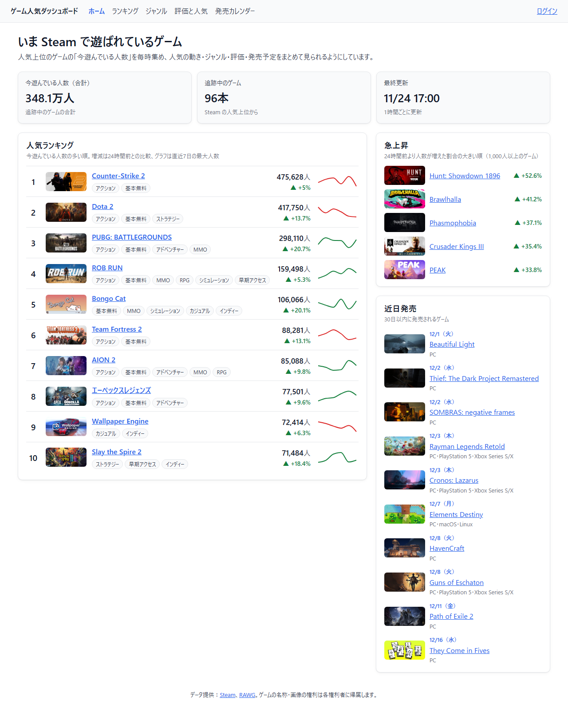
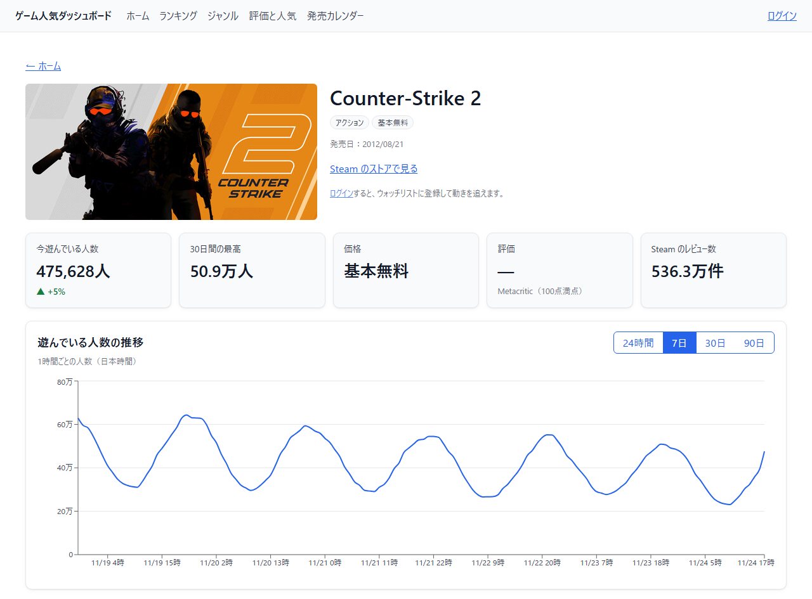
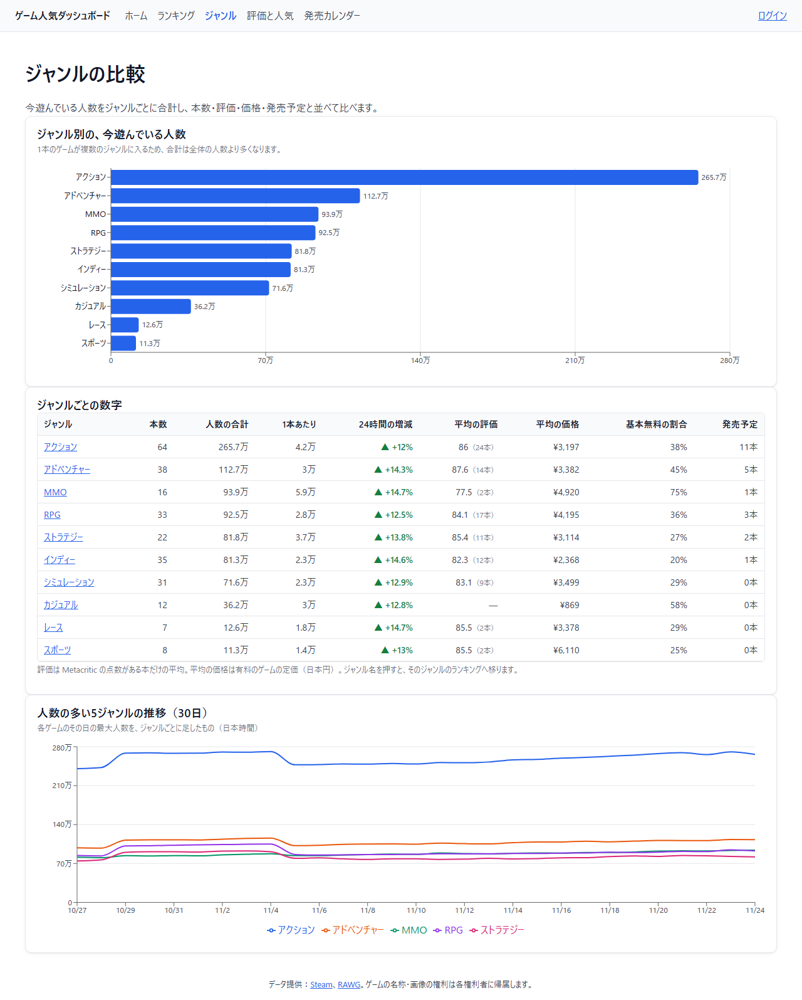
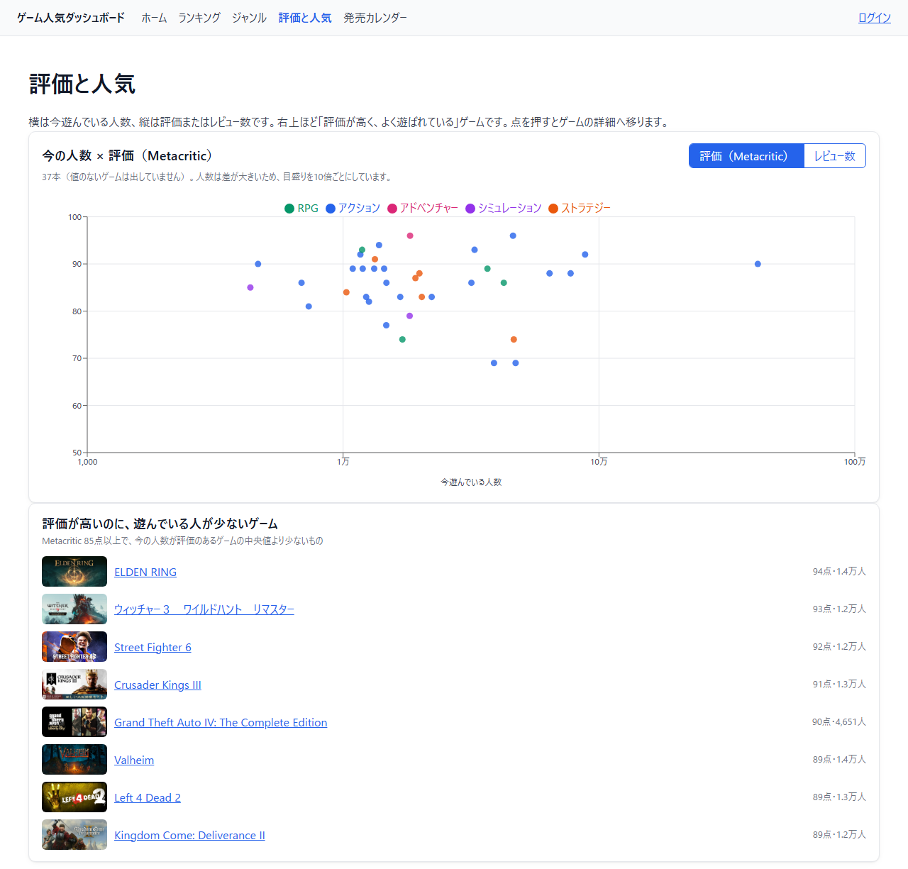

# ゲーム人気ダッシュボード（game-trend-dashboard）

**Steam で今遊ばれているゲームの人数を毎時集めて、人気の動き・ジャンル・評価・発売予定をグラフで見られるようにした社内向けダッシュボードです。**
企画や営業の担当者が「今どのゲームが伸びているか」「どのジャンルが遊ばれているか」「評価は高いのに遊ばれていないゲームはどれか」を、ひと目で確かめられることを目的にしています。



- 公開デモ：準備中（Railway に公開したら、ここに URL を載せます）
- 閲覧はログインなしでできます。ログインすると、ウォッチリストと管理画面が使えます
- データ提供：[Steam](https://store.steampowered.com/)、[RAWG](https://rawg.io/)。ゲームの名称・画像の権利は各権利者に帰属します

※ キャプチャは手元の開発環境の画面です。最新の人数は Steam から取得した実際の値ですが、過去の推移は開発用に作った仮のデータ（`app:seed-history`）です。

## 画面

| 画面 | 何が分かるか |
| --- | --- |
| ホーム | 合計人数、人気上位10本（7日間の小さなグラフ付き）、24時間で急に増えたゲーム、30日以内の発売予定 |
| ランキング | 人数・増減・評価・レビュー数・価格・発売日で並べ替え、ジャンルと価格（無料・有料・セール中）で絞り込み |
| ゲームの詳細 | 人数の推移（24時間〜90日）。1日ごとの表示ではセールの期間を色で重ねる |
| ジャンルの比較 | ジャンルごとの人数・本数・平均の評価・平均の価格・基本無料の割合・発売予定と、30日間の推移 |
| 評価と人気 | 人数（横・対数）と評価（縦）の散布図。「評価が高いのに遊ばれていないゲーム」の一覧 |
| 発売カレンダー | 月ごとの発売本数と、日ごとの発売予定 |
| ウォッチリスト（ログイン後） | 気になるゲームを50本まで登録し、人数と増減をまとめて見る |
| 管理（admin） | 取得処理ごとの最後の結果と実行の履歴、データの新しさ、集計から外すゲーム、ユーザー、操作の履歴 |

<table>
<tr>
<td></td>
<td></td>
<td></td>
</tr>
<tr>
<td align="center">ゲームの詳細</td>
<td align="center">ジャンルの比較</td>
<td align="center">評価と人気</td>
</tr>
</table>

## しくみ

```
cron-job.org（毎時7分）
   │ GitHub の API で起動
   ▼
GitHub Actions ── php artisan app:collect ──▶ Steam の API / RAWG の API
   │                                          （人気上位・人数・価格・ジャンル・評価・発売予定）
   ▼
Supabase（PostgreSQL） ◀── Railway（Laravel の API ＋ React の画面）◀── ブラウザ
```

- **自分でデータをためる**：Steam の API は「今の人数」しか返さないため、毎時の人数を `player_snapshots` にため、1日ごとの最大・平均を `daily_stats` に集計します。毎時の生データは90日で消し、1日ごとの集計を残します（Supabase の無料枠 500MB に収めるため）
- **失敗に強い取得**：外部 API の時間切れには再試行し、一部のゲームで失敗しても全体は止めません。同じ時刻を2回取っても重複しません。処理ごとの結果（成功・一部失敗・失敗、件数、エラー）を `fetch_runs` に残し、管理画面で見られます
- **Steam と RAWG の名寄せ**：RAWG の発売予定を Steam のゲームと結び付け、両方の情報を1本のゲームにまとめます
- **閲覧のキャッシュ**：集計の結果を、最新の取得時刻を名前に入れて1時間キャッシュします。新しいデータが入ると自動で作り直されるので、古い結果を消す処理が要りません
- **費用ほぼ0円**：DB は Supabase の無料枠、毎時の取得は GitHub Actions（公開リポジトリのため無料）、画面は Railway で必要なときだけ起動します。GitHub の定期実行は数時間遅れることがあったため、外部の cron から起動しています

## 技術

| 分野 | 使っているもの |
| --- | --- |
| フロントエンド | React 19、TypeScript、Vite、React Router、TanStack Query、Recharts |
| サーバー | PHP 8.5、Laravel 13、Sanctum（クッキーでのログイン）、FrankenPHP |
| DB | PostgreSQL 17（本番は Supabase） |
| テスト・確認 | PHPUnit（64件）、Vitest（51件）、axe-core、oxlint、Pint、GitHub Actions の CI |
| 本番 | Railway（Docker）、GitHub Actions、cron-job.org |

## 募集要件との対応

HAL研究所「コーポレートウェブシステムエンジニア」の要件と、このリポジトリで確かめられる箇所です。

| 要件 | このリポジトリでの対応 | 見る場所 |
| --- | --- | --- |
| HTML / CSS | 意味に合った要素（表・見出し・リスト）、明るい表示と暗い表示、スマホの幅に合わせた配置、WCAG 2.1 AA を目標にしたアクセシビリティ | `frontend/src/index.css`、[docs/accessibility.md](docs/accessibility.md) |
| TypeScript / React | 13画面の SPA。API の型を定義し、TanStack Query で取得とキャッシュ、楽観的な更新（ウォッチリストの解除） | `frontend/src/pages/`、`frontend/src/lib/` |
| PHP | Laravel の API、外部 API から取得するコマンド、権限（Policy）、操作の履歴 | `backend/app/` |
| SQL | 集計を1回の SQL で行い、ゲームの本数によらず SQL の回数を一定にする。`DISTINCT ON`、`generate_series`、`EXPLAIN ANALYZE` での調査 | `backend/app/Http/Controllers/`、[docs/performance.md](docs/performance.md) |
| フロントエンドとサーバーサイドの両方 | 画面・API・DB・定期処理・本番の構成まで1人で作成 | このリポジトリ全体 |
| （歓迎）データベース設計 | 生データと1日ごとの集計の二層、保存期間、索引と読む SQL の対応、外部キーと削除時の扱い | `backend/database/migrations/`、[docs/performance.md](docs/performance.md) |
| （歓迎）利用者100名以上のサービス | 集計結果のキャッシュ、本番の約20倍のデータで全 API が 90ms 以内（キャッシュなし）、役割ごとの権限と操作の履歴、取得の失敗を管理画面で見られる | [docs/performance.md](docs/performance.md)、`backend/app/Services/Dashboard/PlayerStats.php` |

## 手元で動かす

Windows の WSL2（Ubuntu）と Docker Desktop で開発しています。

```bash
# サーバー（Laravel Sail：PHP と PostgreSQL）
cd backend
cp .env.example .env            # RAWG_API_KEY に自分のキーを入れる（https://rawg.io/apidocs）
composer install                # PHP が手元にない場合は Sail の説明に従う
./vendor/bin/sail up -d
./vendor/bin/sail artisan key:generate
./vendor/bin/sail artisan migrate --seed     # ログイン用のアカウント（下の表）を作る
./vendor/bin/sail artisan app:collect        # Steam と RAWG から取得する（初回は数分かかる）
./vendor/bin/sail artisan app:seed-history   # 任意：過去の推移の仮データを入れる（本番では動かない）

# 画面（Vite）
cd ../frontend
npm ci
npm run dev                     # http://localhost:5173
```

| アカウント | パスワード | できること |
| --- | --- | --- |
| member@example.com | password | 閲覧、ウォッチリスト |
| admin@example.com | password | 上に加えて、管理画面（取得の状況、ゲーム、ユーザー、操作の履歴） |

テスト：

```bash
cd backend && ./vendor/bin/sail artisan test
cd frontend && npm test && npm run typecheck && npm run lint
```

## 文書

- [docs/plan.md](docs/plan.md)：作業計画と進み具合、設計で決めたこと
- [docs/deploy.md](docs/deploy.md)：本番（Supabase、GitHub Actions、cron-job.org、Railway）の手順
- [docs/performance.md](docs/performance.md)：大量データでの速さの確認
- [docs/accessibility.md](docs/accessibility.md)：アクセシビリティの確認
